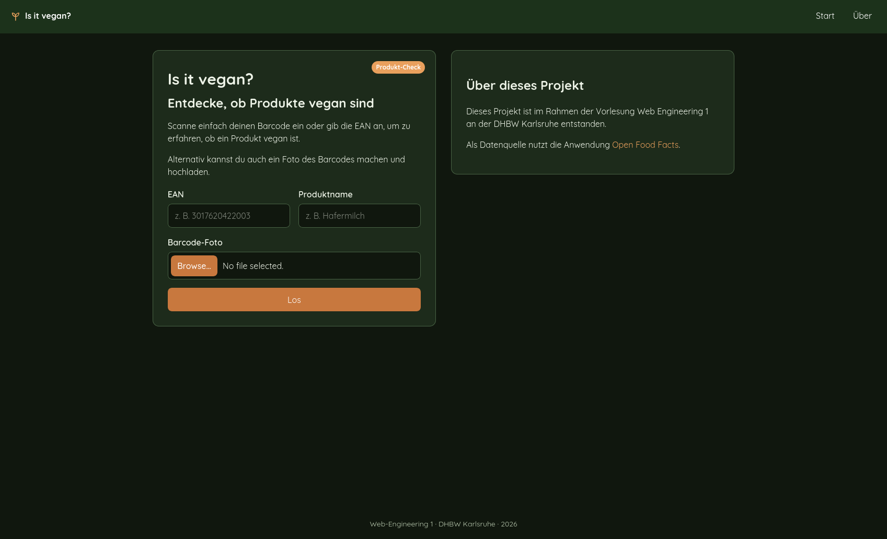
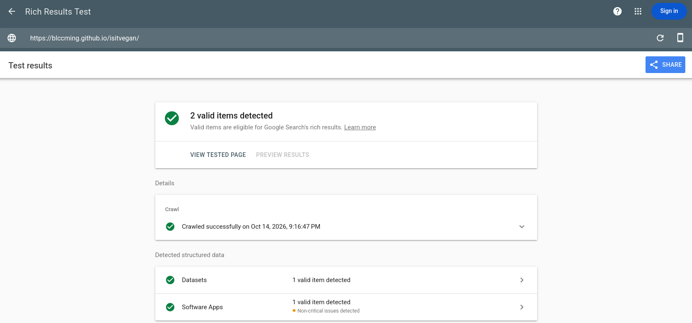

# Is it vegan?

Eine App, die dir hilft, herauszufinden, ob ein Produkt vegan ist. Scanne einfach den Barcode und die App zeigt dir an, ob das Produkt für deine Ernährungsform geeignet ist.

**Live:** [blccming.github.io/isitvegan/](https://blccming.github.io/isitvegan/)
**Team:** Oliver Kühn

Die Website ist als Single-Page aufgebaut. Die Navigation springt über Anker direkt zu den Bereichen `#start` und `#ueber`.

## Screenshot



## Was die App kann

- Produkte über einen Barcode mit der Kamera scannen.
- Eine EAN-Nummer manuell eingeben und suchen.
- Produktdaten über die Open-Food-Facts-API abrufen.
- Anzeigen, ob ein Produkt vegan ist, und die dazugehörigen Produktinformationen darstellen.
- Eine verständliche Rückmeldung anzeigen, wenn ein Produkt nicht gefunden werden kann.

## Alternative Appideen
Zu Übungsblatt 1, Bonusaufgabe B: Ich ließ durch KI 5 Appideen generieren. 
Prompt: "Generiere mir 5 Projektideen für eine Webapp, die den Alltag erleichtern."

| Idee                                          | Beschreibung                                                                                      | Ablehnungsgrund                                                                                                                                                                         |
|-----------------------------------------------|---------------------------------------------------------------------------------------------------|-----------------------------------------------------------------------------------------------------------------------------------------------------------------------------------------|
| SmartPlaner für den Haushalt                  | Einkaufslisten, Putzpläne, Mülltermine und wiederkehrende Aufgaben zentral verwalten.             | Besser durch bestehende Kalenderapp bzw. TODOs-App lösbar; für mich kein Mehrwehrt                                                                                                      |
| Alltags- und Terminassistent                  | Termine und Erledigungen priorisieren und daraus eine passende Tagesplanung erstellen.            | Ebenfalls durch bestehende Kalender- bzw. TODOs-App lösbar bzw. sind diese besser geeignet                                                                                              |
| Meal- und Einkaufsplaner                      | Gerichte nach Budget, Ernährungsform und vorhandenen Zutaten planen und Einkaufslisten erstellen. | Coole Idee, aber besser als native Smartphoneapp machbar                                                                                                                                |
| Gemeinschaftsorganisator für WGs und Familien | Gemeinsame Ausgaben, Aufgaben, Termine und Abstimmungen organisieren.                             | Würde Accountsystem benötigen, das ich im Rahmen des Projekts nicht implementieren möchte. Alternativ: externe Authentifikation; möchte ich aber ebenfalls nicht für diese Projekt tun. |
| Lokal-Helfer für den Alltag                   | Relevante lokale Informationen wie Öffnungszeiten, Abholtermine und Verkehr gebündelt anzeigen.   | Bereits bestehende Lösungen wie Google Maps, die das Problem hinreichend lösen.                                                                                                         |

Ich habe mich schließlich vom Meal- und Einkaufsplaner inspirieren lassen. 
Ein Problem, das mir häufiger beim Einkaufen begegnet ist, ist, dass Produkte mit tierischen Inhaltsstoffen nicht immer klar gekennzeichnet sind bzw. nur mit Mehraufwand (Zutatenliste lesen) von veganen Produkten zu unterscheiden sind. 
Ich möchte eine App bauen, die mir beim Einkaufen hilft, indem sie Produkte scannt und mir anzeigt, ob sie für meine Ernährungsform geeignet sind.

## Datenquelle

- **API:** https://world.openfoodfacts.org
- **Dokumentation:** https://openfoodfacts.github.io/openfoodfacts-server/api/
- Für die Anfragen ist kein API-Key erforderlich.
- Der CORS-Test war erfolgreich: Die API antwortete mit Status `200` und `ok: true`.

## Lokal starten

Abhängigkeiten installieren und den Vite-Entwicklungsserver starten:

```bash
npm install
npm run dev
```

## Technik

Womit gebaut und warum. Eine Zeile pro Entscheidung reicht, aber es soll eine Entscheidung sein, keine Aufzählung von Buzzwords.

## Produktions-Build

Der Vite-Build erzeugt unter `dist/assets/` die CSS-Datei `index-BWa8LM3T.css`. Sie ist aktuell 10,4 KiB groß.

Die Datei bleibt trotz der vielen Tailwind-Klassen klein, weil Tailwind im Produktions-Build nur die Klassen aus dem Projekt übernimmt,
die tatsächlich im HTML und in den Styles verwendet werden. Nicht verwendete Klassen werden nicht übernommen. Zudem wird die Datei komprimiert (Entfernen von Leerzeichen etc.).

## Lokal und live vergleichen

Lokal und live waren gleich, weil dieselben HTML-, CSS- und JavaScript-Dateien verwendet und durch den Produktions-Build einheitlich verarbeitet werden.
Die Falle unterschiedlicher Pfade wurde vermieden, indem alle internen Verweise relativ zur bereitgestellten Website funktionieren.
Die deployte Website wurde während der Entwicklung regelmäßig geprüft, um sicherzustellen, dass alles korrekt dargestellt wird.

## Wiederverwendete Komponenten

Die drei wiederverwendbaren Tailwind-Komponenten sind in `style.css` innerhalb von `@layer components` definiert:

- **`.component-card`:** Produkt-Check-Karte in `#start`.
- **`.button`:** Absende-Button „Los“ im Produktformular.
- **`.produkt-badge`:** „Produkt-Check“-Badge auf der Produktkarte.

## CSS-Kollisionen
Am Beispiel: 
```html
      <h1 id="start-titel">Is it vegan?</h1>
```
`font-size` ist laut body 1rem. Da das Element aber zu h1 gehört (und h1 spezifischer als body ist), wird es von der h1-Definition überschrieben und ist somit 2em groß.

## Rich Results Test / JSON-LD

Der JSON-LD-Block im `<head>` wurde mit dem Google Rich Results Test geprüft:



## KI-Log

Ehrlich ausfüllen, das zählt zur Bewertung.

| Werkzeug | Wofür benutzt |
|----------|----------------|
| Copilot  | Generierung und Bewertung von fünf Ideen für eine Webapp im Rahmen von Übungsblatt 1, Bonusaufgabe B. |
| Copilot  | Unterstützung bei der Umstellung von einer separaten `ueber.html` auf eine Single-Page mit Ankern. |
| Copilot  | Unterstützung bei kurzen Texten für die Meta-Description und die Projektbeschreibung. |
| Copilot  | Unterstützung bei der Planung und Validierung des EAN-Formulars, insbesondere bei der Behandlung der EAN als Text, damit führende Nullen erhalten bleiben. |
| Copilot  | Erstellung und Prüfung von `robots.txt`, `sitemap.xml` und `llms.txt` für Suchmaschinen und KI-Systeme. |
| Copilot  | Erstellung des JSON-LD-Blocks nach Schema.org und Ergänzung der Angaben zu Beschreibung, Lizenz und Creator. |
| Copilot  | Unterstützung bei der responsiven Umsetzung mit Flexbox, Grid und Tailwind. |
| Copilot  | Unterstützung bei der Vite- und Tailwind-Toolchain sowie der README-Dokumentation. |

**Ein Fall, in dem KI geholfen hat:** Was habt ihr gefragt, was kam zurück, was habt ihr geändert?

**Ein Fall, in dem KI falsch lag:** Woran habt ihr es gemerkt, wie habt ihr es gelöst?
